# Dynamic Island for Windows — Enhanced

Улучшенная сборка Dynamic Island for Windows с интеграциями браузерного медиаплеера и Discord. Исходник мода поддерживается отдельно от вспомогательных инструментов.

## 📸 See it in Action

<sub>Демонстрационные рендеры на синтетических данных: визуальная документация,
не скриншоты работающего процесса Windhawk. Генерируются через GitHub Actions.</sub>

<p align="center">
  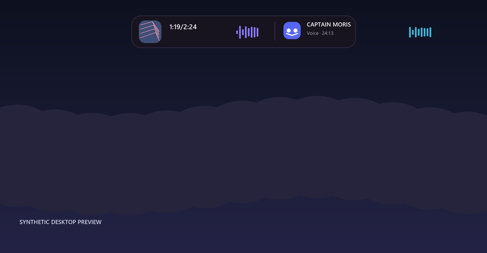
</p>

<p align="center">
  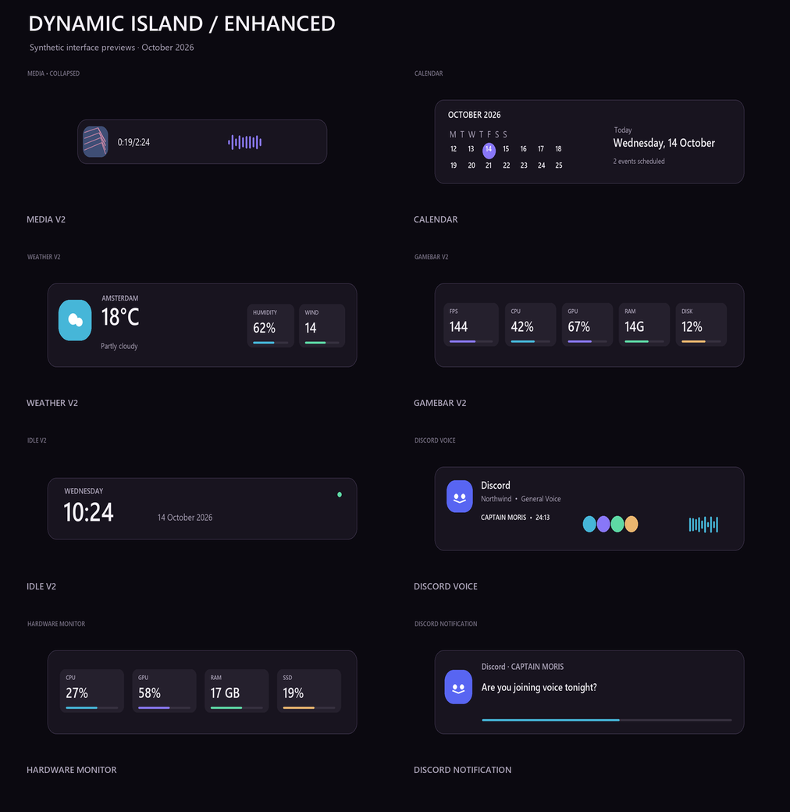
</p>

### Dashboards

| Media Player | Calendar | Weather | Game Overlay | Idle View |
| :---: | :---: | :---: | :---: | :---: |
|  | 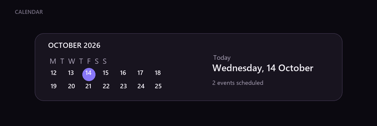 | 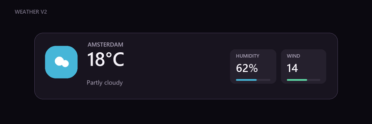 | 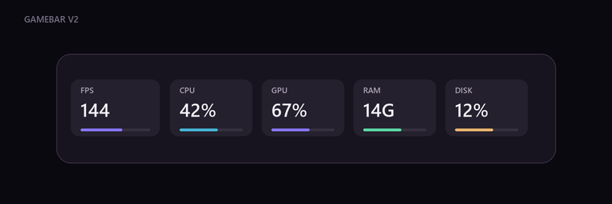 | 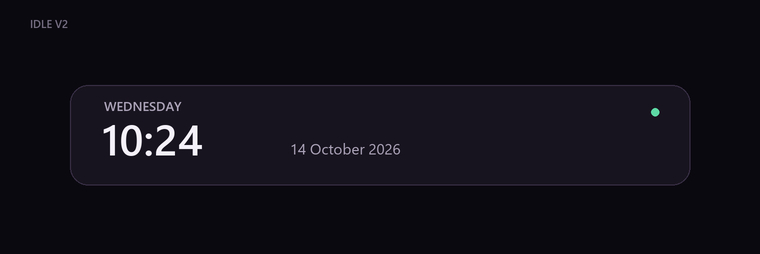 |

### Hardware Monitor

<p align="center">
  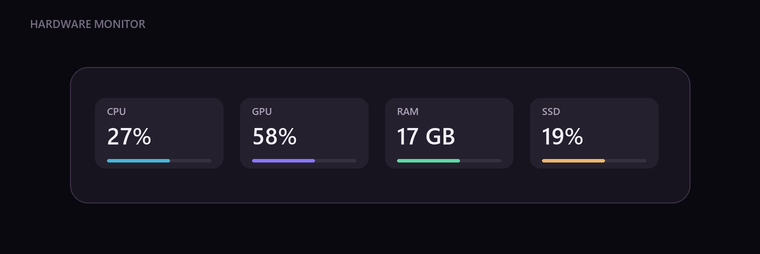
</p>

### Themes

<p align="center">
  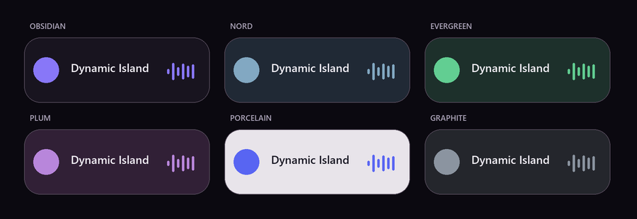
</p>

### Privacy Indicators

| Camera Detected | Microphone Detected |
| :---: | :---: |
| 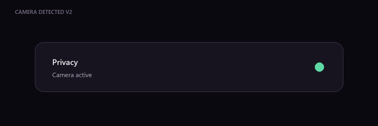 | 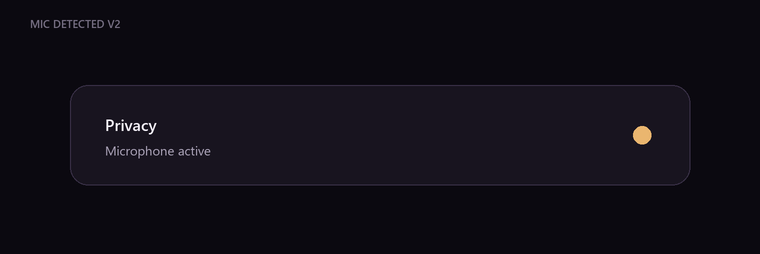 |

### Enhanced — Media & Discord

| Compact Media | Discord Voice | Discord Connected | Discord Notification |
| :---: | :---: | :---: | :---: |
| 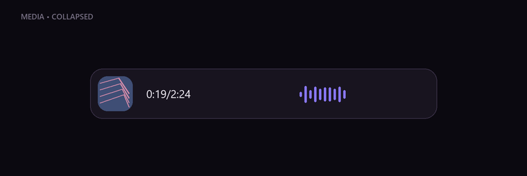 |  | 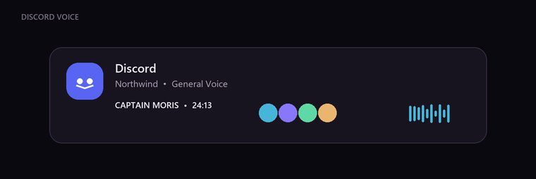 | 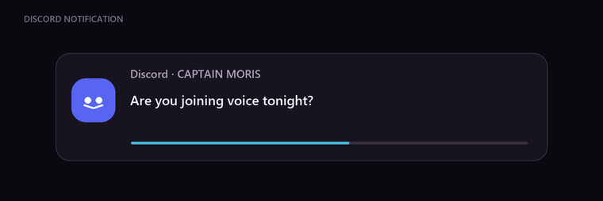 |

### System Events

| Notification | Volume | Brightness | Clipboard |
| :---: | :---: | :---: | :---: |
| 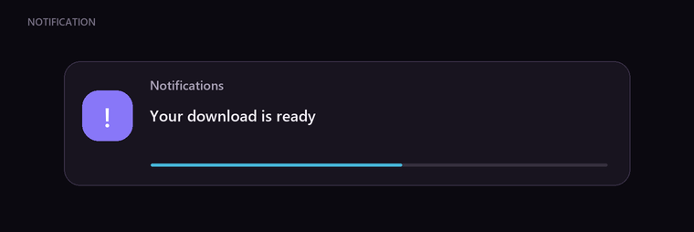 | 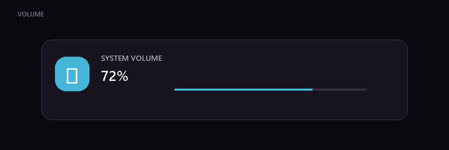 | 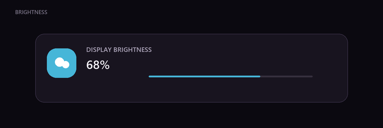 |  |

| Caps Lock | Num Lock | USB / Device | Bluetooth |
| :---: | :---: | :---: | :---: |
| 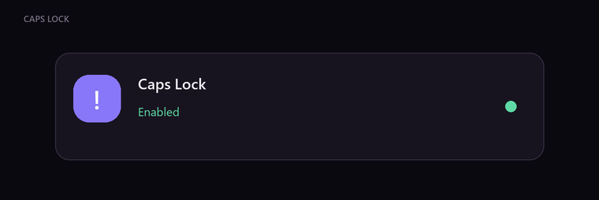 | 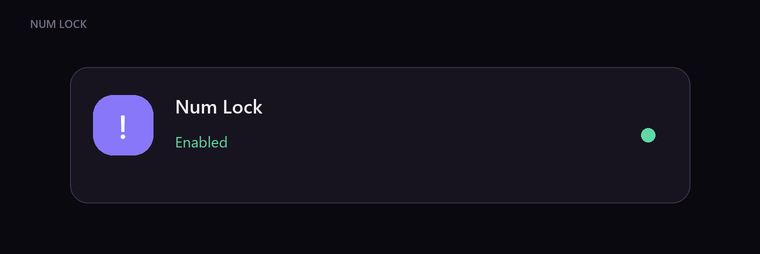 | 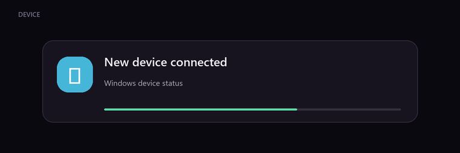 | 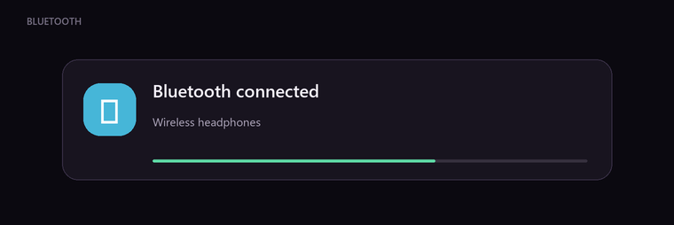 |

| Timer | Battery | Progress | Do Not Disturb |
| :---: | :---: | :---: | :---: |
| 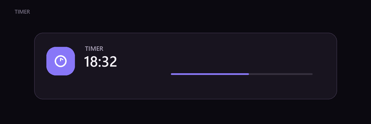 | 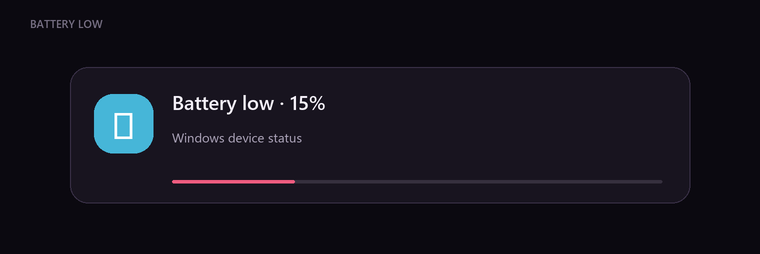 | 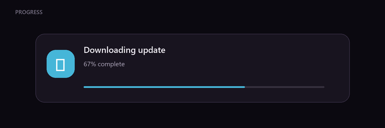 | 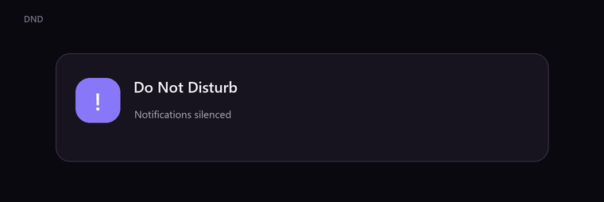 |

| File Tray | Focus Timer | Lyrics | Discord Login |
| :---: | :---: | :---: | :---: |
| 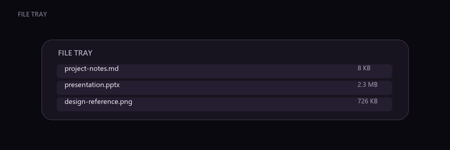 | 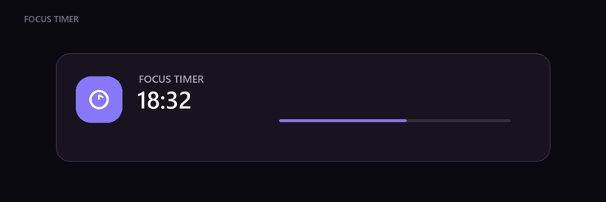 | 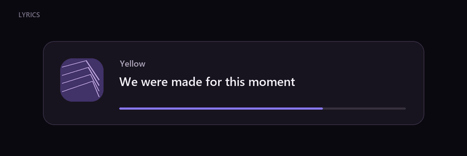 | 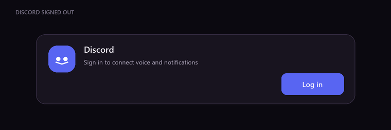 |

Весь набор сценариев (32 PNG) хранится в [previews/](previews/). Изображения
генерирует [scripts/render_previews.py](scripts/render_previews.py) без сети и
без чтения пользовательских данных.

---

## Репозитории и структура

| Компонент                          | Git-репозиторий                                                                                          |
| ---------------------------------- | -------------------------------------------------------------------------------------------------------- |
| Основной мод, сборка и CI          | [Dynamic-Island-for-Windows-Enhanced](https://github.com/QueenDekim/Dynamic-Island-for-Windows-Enhanced) |
| Браузерное медиа                   | [Dynamic-Island-Browser-Media-Plugin](https://github.com/QueenDekim/Dynamic-Island-Browser-Media-Plugin) |
| Discord-интеграция и OAuth backend | [Dynamic-Island-Discord-Integration](https://github.com/QueenDekim/Dynamic-Island-Discord-Integration)   |

```text
src/mod.wh.cpp                   # исходник основного Windhawk-мода
integrations/browser-media/      # Git submodule: extension + Native Messaging + browser bridge
integrations/discord/            # Git submodule: RPC agent + Docker backend + WASAPI bridge
scripts/build.py                 # собирает один автономный C++ файл для редактора Windhawk
dist/mod.wh.cpp                  # результат генерации, не входит в Git
.github/workflows/verify.yml     # проверка сборки в CI
```

## Получение полного проекта

```powershell
git clone --recurse-submodules https://github.com/QueenDekim/Dynamic-Island-for-Windows-Enhanced.git
cd Dynamic-Island-for-Windows-Enhanced
python scripts/build.py
```

Если проект был клонирован без интеграций:

```powershell
git submodule update --init --recursive
python scripts/build.py
```

Готовый **автономный** исходник для Windhawk: **dist/mod.wh.cpp**. Генератор включает C++-мосты обоих submodule в один файл, поэтому Windhawk не нужны локальные include-пути или Git после сборки. В редакторе Windhawk откройте исходник установленного мода, замените содержимое на dist/mod.wh.cpp и скомпилируйте.

Не заменяйте работающий мод напрямую, если в редакторе остались незакоммиченные изменения — сначала сохраните резервную копию.

## Браузерное медиа

Установите расширение из integrations/browser-media/extension в браузер Chromium/Яндекс.Браузер, затем настройте Native Messaging согласно [инструкции компонента](integrations/browser-media/README.md). Это обеспечивает обложки, метаданные трека, таймлайн и управление воспроизведением.

## Discord

Запуск Windows-агента, настройка Discord Developer Portal, OAuth2 и Docker-сервера задокументированы в [Discord README](integrations/discord/README.md). OAuth backend может быть опубликован через HTTPS reverse proxy. Client ID, Client Secret и API-ключ **не должны находиться в Git**.

В Discord-вкладке есть вход/выход, сведения о голосовом канале и новые уведомления. В компактном острове при подключении к голосовому каналу показываются иконка сервера, таймер, микрофон и анимированные столбцы входящего звука.

Discord-индикатор использует **WASAPI Process Loopback для дерева Discord.exe**, а не общий звук Windows. Чувствительность для тихой речи увеличена нелинейным усилением RMS с шумовым порогом; столбцы реагируют одновременно. Аудио не передаётся на backend.

## Разработка

Вносите изменения в соответствующий submodule, коммитьте/публикуйте его **сначала**, затем обновляйте указатель submodule в основном проекте:

```powershell
cd integrations/discord
git add windhawk/discord_bridge.h windhawk/discord_process_loopback.h
git commit -m "Improve Discord audio"
git push

cd ../..
git add integrations/discord
git commit -m "Update Discord integration submodule"
git push

python scripts/build.py
```

Для редактирования интеграций в их исходных репозиториях на Dekim-PC используются C:\Projects\DynamicIslandBrowserMedia и C:\Projects\DynamicIslandDiscord; папки под integrations/ — независимые Git-рабочие копии.

## Проверки

- python scripts/build.py: собирает один исходник из 4 файлов (core + 3 C++ bridge headers).
- Windows + установленный Windhawk Compiler: clang++ -fsyntax-only dist/mod.wh.cpp с флагами редактора Windhawk.
- Тесты браузерной интеграции и Discord-агента находятся в отдельных submodule.
- Проверка уровней звука в реальном звонке необходима после компиляции мода; локальный smoke-тест WASAPI подтверждает создание изолированного захвата.


### Обновление исходника редактора Windhawk на Windows

После python scripts/build.py можно безопасно установить автономный файл в рабочий EditorWorkspace:

~~~powershell
powershell -NoProfile -ExecutionPolicy Bypass -File .\scripts\install_editor.ps1
~~~

Если установленный Windhawk требует доступа администратора к ProgramData, запустите PowerShell с повышенными правами. Скрипт делает резервную копию текущего mod.wh.cpp внутри dist/ и сверяет SHA-256 после копирования. Затем переоткройте редактор Windhawk и скомпилируйте мод.


## Изменения интерфейса: таймер медиа и Discord (2026-10-13)

- В свёрнутом медиаплеере между обложкой и звуковыми столбцами показывается
  время «прошло/всего», например 1:25/3:40. Таймер использует актуальную
  позицию GSMTC или Browser Native Messaging; треки длиннее часа поддерживаются.
- Discord-вкладка включается только при активной настройке модуля и наличии
  процесса Discord.exe. Если Discord закрыт, вкладка не занимает место.
- В голосовом канале Discord находится **на второй вкладке** сразу после
  плеера (или часов при отсутствии медиа). Без звонка вкладка Discord находится
  в конце списка.
- При подключении к голосовому каналу или смене канала (сравнение channel ID)
  остров автоматически открывает расширенный Discord-вид на 5 секунд, по
  принципу всплытия медиаплеера при смене трека.
- Уведомления Discord по возможности используют **аватарку отправителя**
  вместо общего логотипа Discord. Изображения кешируются только локально
  и загружаются исключительно с разрешённых CDN Discord. При отсутствии
  аватара используется прежняя иконка приложения.
- Изолированный захват Discord через WASAPI Process Loopback сохранён.

После обновления Git submodule запустите python scripts/build.py, откройте
dist/mod.wh.cpp в редакторе Windhawk и скомпилируйте. Windows-агент Discord
нужно обновить/перезапустить, чтобы он начал публиковать аватарки сообщений
и стабильный идентификатор текущего голосового канала.


## Automatic Game Overlay

В настройках Windhawk в разделе **Modules** появился переключатель
**Auto Game Mode overlay** (по умолчанию выключен). При включении остров
автоматически показывает существующий игровой оверлей, когда на переднем
плане находится игра, и возвращается к обычным часам/медиа при выходе из
игры или переключении на обычное приложение. Ручная настройка
**Enable game overlay mode** и ручное закрепление игрового оверлея имеют
приоритет над автоматикой.

Для распознавания используются Windows Game Bar GameConfigStore, каталог
игр Steam/Epic/GOG/Riot/EA/Ubisoft, игровые DLL и классы окон популярных
движков (Unity, Unreal, Godot, GLFW, SDL). Для неизвестных исполняемых
файлов полный экран выступает дополнительным эвристическим признаком.
Браузеры, Discord, игровые лаунчеры, медиаплееры и типовые системные
приложения исключены из автоматического распознавания.

**Ограничение:** Windows не предоставляет единого достоверного API,
распознающего абсолютно все игры. Некоторые оконные игры без известных
признаков могут потребовать ручного включения Game Overlay. Для настоящего
эксклюзивного fullscreen режим Always on top зависит от игры и Windows.

Определение выполняется примерно раз в секунду, без фонового сканирования
всех запущенных процессов. Если остров припаркован механизмом auto-hide,
включённая настройка периодически проверяет запуск игры, не расходуя
ресурсы на постоянную отрисовку. Ручное скрытие острова остаётся главным.
В автоматическом режиме настройка Hide on full screen не скрывает игровой
оверлей. Изолированный Discord/Browser Media и Git submodule не изменяются.

Локальная проверка Windows-детектора:
~~~powershell
clang++ -std=c++17 tests/test_game_detection.cpp -o test_game_detection.exe -ladvapi32 -luser32
.\test_game_detection.exe
python scripts/test_features.py
python scripts/build.py
~~~


## Synthetic preview pipeline

README previews follow the upstream project's visual section order:
See it in Action, Dashboards, Hardware Monitor, Themes, Privacy Indicators,
followed by Enhanced features and system events.

All 14 IslandKind values have mapped synthetic scenarios. The 32 PNG files
are generated offline from deterministic synthetic state by
scripts/render_previews.py using Pillow 12.3.0 and native Windows Segoe UI.
They are illustrative renders; they are not screenshots of an actual Windhawk
process and do not read tokens, Discord messages, system sensors, or browser data.

Run locally:

~~~powershell
python -m pip install Pillow==12.3.0
python scripts/render_previews.py
python tests/test_previews.py
~~~

GitHub Actions:
- verify.yml renders and validates all previews, then publishes them as a
  downloadable workflow artifact.
- render-previews.yml runs when UI source or the renderer changes and on manual
  workflow_dispatch. It renders and uploads the gallery, then updates committed
  previews on main only when the PNGs changed.
- Tests verify coverage of every IslandKind and every linked README image.

In the Game Overlay, FPS is sampled into one displayed value no more than once
per second, while the island's normal animation frame pacing stays unchanged.
The displayed counter describes the overlay's own measured frame pacing.
